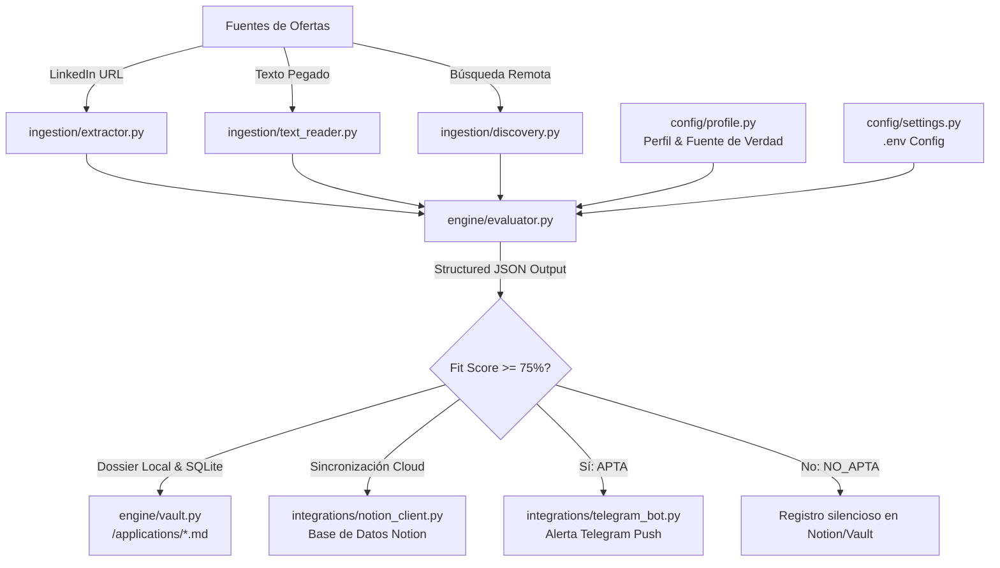

# 🚀 AI Job Hunter & Career Agent

Sistema autónomo en Python para búsqueda, evaluación cuantitativa y orquestación de candidaturas de empleo, evaluadas por IA contra un perfil profesional configurable.

---

## 🏗️ Arquitectura del Sistema



---

## 📂 Estructura del Repositorio

```text
├── config/
│   ├── __init__.py
│   ├── settings.py           # Gestión tipada de variables de entorno (Pydantic Settings)
│   └── profile.py            # Fuente de Verdad del perfil profesional y diferencial
├── engine/
│   ├── __init__.py
│   ├── schemas.py            # Esquema Pydantic para validación de JSON estricto
│   ├── prompts.py            # Prompt Engineering, calibración de score y roles
│   ├── evaluator.py          # Motor de IA (Google Gemini 2.5 Flash / DeepSeek Chat)
│   └── vault.py              # Almacén de dossiers locales en Markdown e historial SQLite
├── ingestion/
│   ├── __init__.py
│   ├── extractor.py          # Extracción HTML con headers de navegador y fallback anti-bot
│   ├── text_reader.py        # Captura interactiva multilínea y lectura de ficheros
│   └── discovery.py          # Búsqueda proactiva de ofertas remotas (--hunt)
├── integrations/
│   ├── __init__.py
│   ├── notion_client.py      # Creación de filas y bloques ricos en Notion DB
│   └── telegram_bot.py       # Notificaciones HTML enriquecidas a Telegram
├── main.py                   # CLI principal interactivo y orquestador
├── requirements.txt          # Dependencias mínimas y probadas
├── .env.example              # Plantilla de variables de entorno
└── README.md                 # Documentación técnica completa
```

---

## ⚡ Instalación Rápida

1. **Crear entorno virtual en Linux/macOS:**
   ```bash
   python3 -m venv .venv
   source .venv/bin/activate
   ```

2. **Instalar dependencias:**
   ```bash
   pip install -r requirements.txt
   ```

3. **Configurar variables de entorno:**
   ```bash
   cp .env.example .env
   nano .env  # o editar con tu editor preferido
   ```

---

## ⚙️ Configuración de Integraciones

### 1. Google Gemini API (Motor de IA Principal)
1. Obtén tu clave en [Google AI Studio](https://aistudio.google.com/).
2. Añádela a tu `.env`:
   ```env
   GEMINI_API_KEY=AIzaSy...
   GEMINI_MODEL=gemini-2.5-flash
   LLM_PROVIDER=gemini
   ```

*(Opcional: Si prefieres DeepSeek, añade `DEEPSEEK_API_KEY` y selecciona `LLM_PROVIDER=deepseek`).*

---

### 2. Base de Datos de Notion (`integrations/notion_client.py`)

1. **Crear una Integración en Notion:**
   - Ve a [Notion Developers: My Integrations](https://www.notion.so/profile/integrations).
   - Pulsa **"New integration"**, asígnale el nombre `AI Job Hunter` y copia el **Internal Integration Secret** (`ntn_...`).
   - Pégalo en tu `.env` como `NOTION_TOKEN`.

2. **Crear la Base de Datos en Notion:**
   - En Notion, crea una nueva página y añade una tabla/base de datos con las siguientes **columnas y tipos exactos**:

   | Nombre de Columna | Tipo de Propiedad en Notion | Descripción |
   | :--- | :--- | :--- |
   | **Título** | `Title` | Nombre del puesto evaluado |
   | **Empresa** | `Text` (Rich Text) | Empresa contratante |
   | **Score** | `Number` | Puntuación de encaje (0 a 100) |
   | **Estado** | `Select` | Opciones: `APTA` (verde), `NO_APTA` (rojo) |
   | **Remoto** | `Checkbox` | Marcado si la posición es 100% remota |
   | **URL** | `URL` | Enlace directo a la oferta original |
   | **Missing Keywords** | `Text` (Rich Text) | Habilidades o tecnologías ausentes |
   | **Nota de Outreach** | `Text` (Rich Text) | Mensaje de conexión para LinkedIn |

3. **Conectar la Integración a tu Base de Datos:**
   - Abre tu base de datos en Notion.
   - Pulsa en los tres puntos `...` (arriba a la derecha) -> **Conexiones** (o **Add connections**) -> Selecciona `AI Job Hunter`.
4. **Obtener el `NOTION_DATABASE_ID`:**
   - Copia la URL de tu base de datos en Notion:
     `https://www.notion.so/workspace/89abcdef0123456789abcdef01234567?v=...`
   - El Database ID es el código de 32 caracteres entre el slash `/` y el signo `?`.
   - Pégalo en tu `.env`:
     ```env
     NOTION_DATABASE_ID=89abcdef0123456789abcdef01234567
     ```

---

### 3. Alertas en Telegram (`integrations/telegram_bot.py`)

1. **Crear el Bot:**
   - Abre Telegram y busca `@BotFather`.
   - Envía `/newbot`, dale un nombre y un username (ej. `my_job_hunter_bot`).
   - Guarda el token generado como `TELEGRAM_BOT_TOKEN`.
2. **Obtener tu Chat ID:**
   - Inicia conversación con tu bot pulsando `Start` (`/start`).
   - Envía cualquier mensaje a `@userinfobot` o abre en el navegador:
     `https://api.telegram.org/bot<TU_BOT_TOKEN>/getUpdates`
   - Copia tu ID numérico y pégalo en tu `.env`:
     ```env
     TELEGRAM_CHAT_ID=123456789
     ```

---

## 💻 Modos de Uso

### 1. Evaluar mediante URL directa de LinkedIn o Web
```bash
python main.py --url "https://www.linkedin.com/jobs/view/4123456789/"
```
*Si LinkedIn bloquea la petición pública por anti-bot o login-wall, el script detecta el bloqueo y conmuta automáticamente a modo pegado interactivo para no interrumpir el flujo.*

### 2. Modo Pegado Interactivo (Recomendado para ofertas tras login)
```bash
python main.py --paste
```
*Copia el texto de la oferta en LinkedIn, pégalo en la terminal y pulsa `Ctrl+D` (o escribe `EOF` en una línea nueva).*

### 3. Evaluar desde un archivo de texto local
```bash
python main.py --file ofertas/puesto_cloud_architect.txt
```

### 4. Modo Caza Proactiva puntual (`--hunt`)
Busca automáticamente ofertas remotas recientes con palabras clave personalizadas:
```bash
python main.py --hunt --keywords "AI Engineer Cloud Architect Google Workspace" --limit 5
```

### 5. Modo Monitorización Continua Autónoma (`--watch`)
Escanea periódicamente en segundo plano y te envía una alerta a Telegram cada vez que encuentra una oferta **APTA** nueva:
```bash
python main.py --watch --interval 120 --keywords "AI Engineer Cloud Automation Google Workspace"
```
*(Ejecuta un rastreo cada 120 minutos, descarta duplicados mediante SQLite sin gastar tokens y te notifica al instante en Telegram)*.

### 6. Modo de Prueba local sin enviar a Telegram (`--dry-run`)
```bash
python main.py --paste --dry-run
```

---

## 📁 Dossier Offline e Historial de Idempotencia

Cada oferta analizada genera:
1. **Archivo Markdown individual** en `/applications/YYYYMMDD_HHMMSS_empresa_puesto.md` con:
   - Resumen, Score y Estado
   - Diagnóstico salarial (cumplimiento del mínimo y objetivo definidos en el perfil)
   - Conciliación y jornada (parcial/completa, horario flexible)
   - Reputación de empresa (filtrado por reputación de empresa)
   - Motivos de encaje y brechas de keywords
   - Consejos para adaptar tu CV
   - Carta de presentación completa (120-150 palabras)
   - Nota de conexión para recruiter (<300 chars lista para copiar)
2. **Registro en SQLite** (`data/job_history.db`):
   - Evita reprocesar la misma URL dos veces, protegiendo tus cuotas y saldo de DeepSeek.

---

## ⏰ Automatización Desatendida (Cron Job en Linux)

Para ejecutar la caza de ofertas remotas automáticamente de lunes a viernes a las 09:00 AM:
```bash
crontab -e
```
Añadir la siguiente línea:
```cron
0 9 * * 1-5 cd "/ruta/a/linkedin-job-hunter" && .venv/bin/python main.py --hunt --limit 5 >> data/cron_hunt.log 2>&1
```
